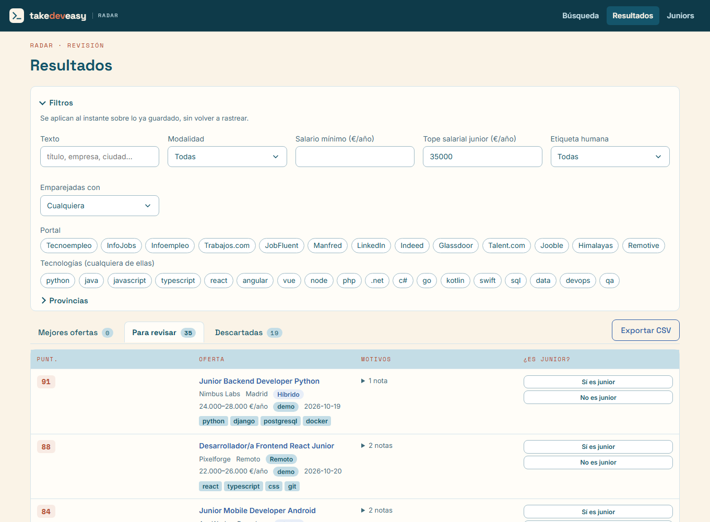
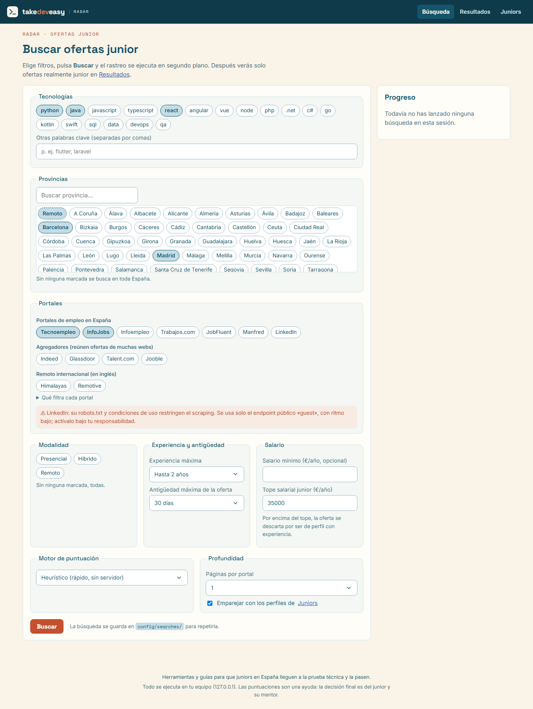
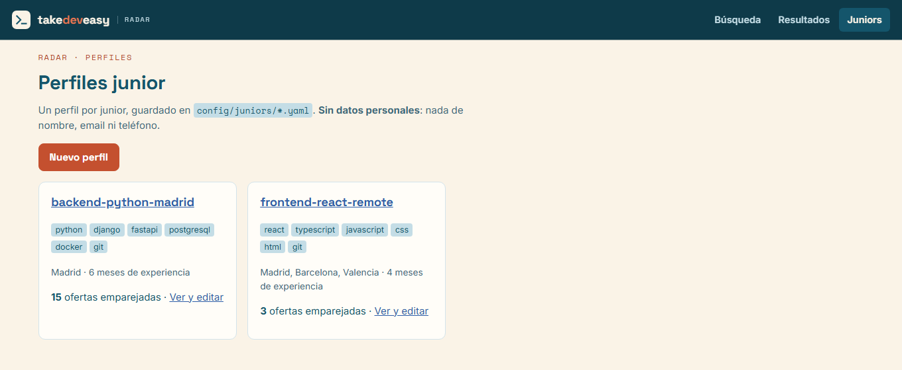

# offerscan

Herramienta local para juniors en España: rastrea ofertas en hasta 13 portales (Tecnoempleo, InfoJobs, Infoempleo, Trabajos.com, JobFluent, Manfred, Indeed, Glassdoor, Talent.com, Jooble, Himalayas, Remotive y, opcional, LinkedIn), descarta las que no son junior y te las enseña en el navegador.

Todo corre en **tu ordenador**. No hay cuenta, no hay nube y no hace falta pagar ninguna API.



## 1. Qué necesitas

- Un PC con **Windows, macOS o Linux**
- **Python 3.10 o superior** ([descarga](https://www.python.org/downloads/) — en Windows marca *Add python.exe to PATH*)
- Conexión a internet
- Unos 1,5 GB libres: ~1 GB del programa y ~200 MB de un navegador Chromium que se descarga solo (más si usas Laya)

No hace falta saber programar a fondo: vas a pegar unos comandos en la terminal y abrir un navegador.

## 2. Descargar el proyecto

El repositorio es público: no necesitas cuenta de GitHub para descargarlo.

**Opción A, sin Git (lo más fácil):** en <https://github.com/takedeveasy/offerscan> pulsa el botón verde **Code → Download ZIP**, descomprime el ZIP donde quieras (por ejemplo en `Documentos`) y entra en la carpeta que se crea, `offerscan-main`.

**Opción B, con Git** (si lo tienes instalado; así luego puedes actualizar con `git pull`):

```bash
git clone https://github.com/takedeveasy/offerscan.git
cd offerscan
```

Abrir una terminal en esa carpeta:

- **Windows:** abre la carpeta en el Explorador, haz clic en la barra de direcciones, escribe `powershell` y pulsa Enter.
- **macOS:** clic derecho sobre la carpeta → **Nuevo terminal en la carpeta** (o abre Terminal y escribe `cd ` y arrastra la carpeta).
- **Linux:** clic derecho dentro de la carpeta → **Abrir en una terminal**.

Comprueba que estás en el sitio correcto: al escribir `dir` (Windows) o `ls` (macOS/Linux) tiene que aparecer `README.md`.

## 3. Instalar

Desde esa terminal, **en la carpeta del proyecto**:

### Opción rápida: script

**Windows (PowerShell):**

```powershell
powershell -ExecutionPolicy Bypass -File .\scripts\setup.ps1
.\.venv\Scripts\offerscan ui
```

En Windows, los comandos `offerscan …` de este README se escriben como `.\.venv\Scripts\offerscan …` (por ejemplo `.\.venv\Scripts\offerscan doctor`). Así no hace falta activar el entorno, algo que Windows bloquea por defecto.

**macOS y Linux:**

```bash
bash scripts/setup.sh
source .venv/bin/activate
offerscan ui
```

El script, de principio a fin:

1. Comprueba que tienes Python 3.10+.
2. Crea un entorno aislado en `.venv` (no toca el resto de tu ordenador).
3. Instala el programa y sus dependencias.
4. Copia `.env.example` a `.env` (no hace falta rellenarlo).
5. Descarga el **navegador Chromium** que se usa cuando un portal bloquea (ver [El navegador](#el-navegador-para-portales-que-bloquean)) y **comprueba que arranca**.

Al final verás `Navegador listo` y `Listo. Arranca la interfaz con:`. Si el navegador no se pudo instalar, el script lo dice con un **AVISO**: todo lo demás funciona y puedes repetir ese paso más tarde con `offerscan install-browser`.

> **Windows:** cierra `offerscan ui` (Ctrl+C en su terminal) antes de volver a ejecutar el script; si está abierto, el script te lo pedirá y no tocará nada.

### A mano (si el script no te va)

**Windows**

```powershell
py -3 -m venv .venv
.\.venv\Scripts\python -m pip install -e ".[ui]"
copy .env.example .env
.\.venv\Scripts\offerscan install-browser
.\.venv\Scripts\offerscan ui
```

**macOS y Linux**

```bash
python3 -m venv .venv
source .venv/bin/activate
python -m pip install -e ".[ui]"
cp .env.example .env
offerscan install-browser
offerscan ui
```

Se abre http://127.0.0.1:8765 (solo en tu máquina). Para parar: Ctrl+C en la terminal.

Cada vez que quieras usarlo, abre una terminal en la carpeta del proyecto y lanza la interfaz: `.\.venv\Scripts\offerscan ui` en Windows, o `source .venv/bin/activate` y `offerscan ui` en macOS y Linux.

Para comprobar que todo está bien, lanza `offerscan doctor`. Es normal que salga **AVISO** en `JEV_API_KEY`, `Credenciales InfoJobs` y `Servidor Laya`: son extras opcionales y sin ellos el programa funciona.

### El navegador para portales que bloquean

La mayoría de portales se leen con peticiones normales. **InfoJobs, Indeed y Glassdoor** a veces bloquean o piden captcha; entonces el programa reintenta esa página con un **Chromium sin ventana** (la sesión *stealth* de Scrapling). Ese Chromium no viene con Python: se descarga una vez (~200 MB) y se guarda fuera del proyecto, en la caché de tu usuario.

```text
offerscan install-browser          # descarga Chromium y comprueba que arranca
offerscan install-browser --check  # solo comprueba, sin descargar
offerscan doctor                   # la fila «Navegador stealth» debe decir OK
```

- Lo instala el script de instalación; solo tienes que lanzarlo a mano si viste el **AVISO** o si `offerscan doctor` lo marca.
- Tras actualizar el proyecto (`git pull` + `pip install -e ".[ui]"`), vuelve a lanzar `offerscan install-browser`: una versión nueva puede necesitar otro Chromium.
- **Linux:** Chromium necesita algunas librerías del sistema. Si `install-browser` dice que está instalado pero *no arranca*, ejecuta `sudo .venv/bin/python -m patchright install-deps chromium` (o `offerscan install-browser --with-deps` como root).
- No uses `scrapling install` para esto: si una vez terminó, ya no vuelve a descargar aunque falte el navegador.
- Sin el navegador todo sigue funcionando; solo esos tres portales pueden quedarse a 0 cuando bloquean.

## 4. Primera búsqueda (para que salga algo)

En **Búsqueda**:



1. Deja **Python** (o tu stack) y **Madrid** / **Remoto**.
2. Marca solo **Tecnoempleo** la primera vez. InfoJobs a veces pide captcha; LinkedIn está restringido por sus condiciones de uso.
3. Motor: **Heurístico** (no hace falta ningún servidor extra).
4. Páginas por portal: **1**.
5. Pulsa **Buscar** y espera al recuadro de progreso.
6. Entra en **Resultados**. La mayoría caerá en *Para revisar*: ábrela y usa **Sí es junior** / **No es junior**.

Eso ya es el flujo útil: no esperes una lista mágica de “mejores” a la primera.

Cuando eso funcione, añade más portales. En **Búsqueda** están agrupados:

- **Portales de empleo en España**: Tecnoempleo, InfoJobs, Infoempleo (con «0 años» de experiencia usa su sección *Primer empleo*), Trabajos.com, JobFluent (startups; solo Madrid, Barcelona, Valencia y remoto) y Manfred (pocas ofertas, todas tech y con salario).
- **Agregadores**: Indeed, Glassdoor, Talent.com y Jooble. Reúnen ofertas de otras webs, así que verás repetidas (se agrupan solas).
- **Remoto internacional**: Himalayas (remoto abierto a España, nivel inicial) y Remotive. Ofertas en inglés.

En «Qué filtra cada portal», debajo de las casillas, tienes el detalle de cada uno.

## 5. Tu perfil de junior

En **Juniors** crea un perfil con tu stack, provincias y salario mínimo. **Sin nombre, email ni teléfono.**

Hay dos ejemplos (`backend-python-madrid` y `frontend-react-remote`) que puedes duplicar.



## 6. Si algo falla

| Qué ves | Qué hacer |
|---|---|
| `python` / `py` no se reconoce | Reinstala Python y marca *Add to PATH*. Cierra y abre la terminal. |
| Windows bloquea el script | Usa el comando con `-ExecutionPolicy Bypass` de arriba, o los pasos “a mano”. |
| `pip install` tarda o falla | Reintenta. Hace falta red estable; la primera vez descarga bastante. |
| La interfaz no abre | Comprueba que la terminal dice `offerscan UI en http://127.0.0.1:8765` y entra a esa URL. |
| No sé dónde está la carpeta / `setup.ps1` no existe | No estás en la carpeta del proyecto. Mira el paso 2: `dir`/`ls` tiene que mostrar `README.md`. |
| `offerscan está abierto…` al instalar | Cierra `offerscan ui` con Ctrl+C y repite el script. |
| AVISO del navegador al instalar, o «falta el navegador stealth» en un portal | Con el entorno activado: `offerscan install-browser`. Ver [El navegador](#el-navegador-para-portales-que-bloquean). |
| `Chromium esta instalado pero no arranca` (Linux) | `sudo .venv/bin/python -m patchright install-deps chromium` |
| InfoJobs, Indeed o Glassdoor a 0 ofertas / captcha | Comprueba `offerscan doctor` (fila «Navegador stealth») y baja el ritmo: busca menos tecnologías a la vez. |
| JobFluent a 0 ofertas | Solo tiene Madrid, Barcelona, Valencia y remoto. |
| Remotive a 0 ofertas | Su robots.txt no permite su API; ver `config/search.yaml`. |
| «Laya no responde» | Elige motor **Heurístico**, o instala Laya (apartado extra). |
| `offerscan` no se reconoce | En Windows escríbelo como `.\.venv\Scripts\offerscan`. En macOS y Linux, activa antes el entorno con `source .venv/bin/activate`. |
| «la ejecución de scripts está deshabilitada en este sistema» | Has intentado lanzar `Activate.ps1`. No hace falta: usa `.\.venv\Scripts\offerscan ui`. |
| `OSError: [Errno 2] No such file or directory` con una ruta muy larga (Windows) | La carpeta está demasiado anidada para Windows. Mueve el proyecto a una ruta corta (por ejemplo `C:\offerscan`), borra `.venv` y repite el script. |

Comprueba el entorno:

```text
offerscan doctor
```

## Extra: motor Laya (gratis, opcional)

Afina un poco mejor qué ofertas son junior. Es un programa aparte (~650 MB) que deja un servidor en tu PC.

**Windows**

```powershell
.\scripts\laya.ps1 -Install
.\scripts\laya.ps1
```

**macOS y Linux**

```bash
bash scripts/laya.sh --install
bash scripts/laya.sh
```

Déjalo abierto y, en otra terminal, `offerscan ui` → motor **Laya**.

## Extra: línea de comandos

Con el entorno activado:

```text
offerscan doctor
offerscan run --engine heuristic --sources tecnoempleo --max-pages 1
```

Informes en `reports/`. Detalle para quien toque el código: [docs/DESARROLLO.md](docs/DESARROLLO.md).

## Aviso

Las puntuaciones son una ayuda. Tú decides a qué aplicar.

Usa la herramienta en tu equipo, con ritmo bajo, **sin iniciar sesión** en los portales. Tecnoempleo es el más estable. InfoJobs, Indeed y Glassdoor pueden bloquear. LinkedIn desactívalo salvo que aceptes sus condiciones: su robots.txt restringe este uso.

No subas tu `.env` ni la carpeta `data/` a ningún sitio público.

## Licencia

[MIT](LICENSE). Los portales rastreados tienen sus propias condiciones de uso: respeta su `robots.txt` y úsalo con un ritmo razonable.
